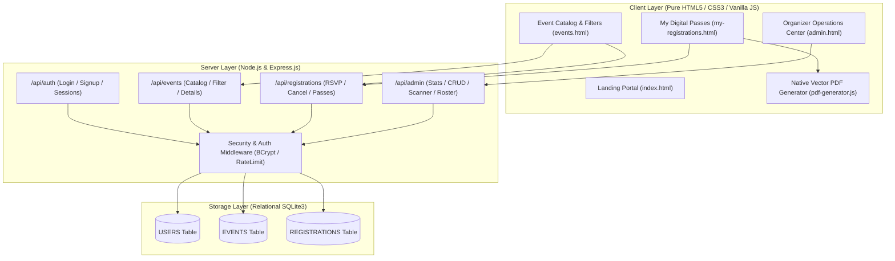

# 🎓 CampusConnect — Campus Event Management & Registration Portal

<div align="center">


[🌟 Live Repository](https://github.com/Shristikumari06/campus-event-management) • [📖 Documentation](#-core-system-modules) • [⚡ Quick Start](#-quick-start--installation) • [🎯 Viva Walkthrough](#-academic-submission--viva-presentation-guide)

</div>

---

## 📑 Table of Contents

- [🌟 1. Executive Summary & Problem Statement](#-1-executive-summary--problem-statement)
- [✨ 2. Flagship Capabilities & Technical Innovations](#-2-flagship-capabilities--technical-innovations)
- [🎯 3. Core System Modules (Prompt Requirements)](#-3-core-system-modules-prompt-requirements)
- [🏗️ 4. System Architecture & Information Flow](#️-4-system-architecture--information-flow)
- [🛠️ 5. Technology Stack Deep-Dive](#️-5-technology-stack-deep-dive)
- [🗄️ 6. Relational Database Schema & Data Models](#️-6-relational-database-schema--data-models)
- [📡 7. RESTful API Endpoint Directory](#-7-restful-api-endpoint-directory)
- [⚡ 8. Quick Start & Installation Guide](#-8-quick-start--installation-guide)
- [🔐 9. Authentication & Pre-Seeded Evaluation Credentials](#-9-authentication--pre-seeded-evaluation-credentials)
- [🛡️ 10. Security & Defense-in-Depth Mechanisms](#️-10-security--defense-in-depth-mechanisms)
- [🎓 11. Academic Submission & Viva Presentation Guide](#-11-academic-submission--viva-presentation-guide)
- [📂 12. Complete Directory Architecture](#-12-complete-directory-architecture)

---

## 🌟 1. Executive Summary & Problem Statement

Across higher education universities and engineering institutions, student event management has historically suffered from:
- 📢 **Communication Fragmentation**: Scattered WhatsApp groups, telegram notices, paper bulletin board flyers, and missed deadlines.
- 📉 **Auditorium Chaos & Over-Registration**: Manual Google Forms or paper sheets causing severe hall overcrowding, duplicate registrations, and inaccurate headcounts.
- ❌ **Lack of Verification**: Vulnerable gate check-ins with no scannable tickets, no student eligibility checks, and zero real-time attendee tracking.

### 💡 The CampusConnect Solution
**CampusConnect** is a centralized, high-performance web portal built from the ground up to automate the entire university event lifecycle. Organizers have absolute control over seat capacity, eligibility criteria, and gate scanners; students enjoy an ultra-fast, luxury glassmorphic interface to reserve seats with 1-click and immediately download **official, standalone vector PDF entry passes**.

---

## ✨ 2. Flagship Capabilities & Technical Innovations

- 📄 **Direct Client-Side Vector PDF Generator (`js/pdf-generator.js`)**:
  - Automatically compiles standard **PDF 1.4 vector binary streams** in memory.
  - Zero external npm/cloud dependencies; generates printable entry passes (`CampusConnect-Pass-*.pdf`) with embedded barcodes, student roll IDs, and gate instructions.
- 🛡️ **Live Auditorium Gate Control & Ticket Scanner (`admin.html`)**:
  - Organizers and security personnel scan or input ticket codes (`CC-2026-01-0042`) at hall entrances for instantaneous check-in validation and attendance status toggling.
- 🎯 **Eligibility Criteria Enforcement**:
  - Organizers define precise student prerequisites (e.g., *"Teams of 2-4 Students (UG/PG All Branches)"*, *"Valid Student ID Required"*), visible across catalog cards, detailed modals, and downloaded passes.
- 📊 **Real-Time Seat Countdown & Anti-Overbooking Engine**:
  - Live visual progress bars and dynamic counters (`"115 remaining of 400 seats"`); server-side SQLite transactions instantly reject registrations once capacity is filled (`HTTP 400`) and disallow duplicates (`HTTP 409 Conflict`).
- 🏆 **Ceremonial University Certificate of Participation**:
  - Built-in credential engine rendering gold-framed official certificates with Dean signatures, verification codes, and 1-click **PDF download**.
- 📅 **1-Click Google Calendar Synchronization**:
  - Pre-computes event schedules, venue coordinates, and student pass IDs into direct Google Calendar templates.
- 📑 **Participant Roster CSV Exporter**:
  - Administrative 1-click export of registered student lists (Roll IDs, departments, emails, timestamps, attendance status) for departmental accreditation.
- ⚡ **Dual-Runtime Execution Support**:
  - Works **100% offline via direct browser file access (`file:///`)** AND as a full-stack production server via Node.js/Express (`http://localhost:3000` / `3001`).

---

## 🎯 3. Core System Modules (Prompt Requirements)

| Module | Purpose | Key Functionality |
| :--- | :--- | :--- |
| 🎪 **Multi-Category Event Management** | Organizes diverse campus activities | Dedicated discovery for **College Fests**, **Workshops**, **Seminars**, **Competitions/Hackathons**, **Technical**, **Cultural**, and **Sports**. |
| ✍️ **Organizer Event Creation** | Administrative event builder | Configure schedules (start/end/deadline), venues, descriptions, **Eligibility Criteria**, poster URLs, and max seat limits. |
| 🎟️ **Student Registration & RSVP** | Frictionless seat reservation | 1-click instant registration, animated confetti celebrations, dynamic seat allotment, and duplicate booking prevention. |
| 🪑 **Live Seat-Limit & Availability** | Accurate capacity tracking | Real-time seat calculation, color-coded capacity meters, automatic `Full Capacity` / `Closed` lockout badges. |
| 📱 **Downloadable & Printable PDF Passes** | Official gate verification slip | Produces downloadable `.pdf` slips containing official crests, barcodes, student credentials, and venue reporting rules. |
| 🔔 **Notification & Status Feedback** | Instant user guidance | Toast alert notifications for seat bookings, cancellations, gate verifications, and quota alerts. |
| 🛡️ **Organizer / Dean Dashboard** | Operational control tower | Macro metrics (total students, active events, registrations), auditorium ticket scanner, event CRUD, and roster management. |

---

## 🏗️ 4. System Architecture & Information Flow



---

## 🛠️ 5. Technology Stack Deep-Dive

### 🎨 Frontend Architecture
- **HTML5 (Semantic & Accessible)**: Built strictly with semantic elements (`<header>`, `<main>`, `<section>`, `<article>`, `<table>`), fully compliant with screen readers and keyboard navigation.
- **Modern CSS3 (Design Tokens & Glassmorphism)**:
  - Custom CSS variables for luxury dark navy palette (`#070a14`), neon pink (`#ff0080`), electric cyan (`#06b6d4`), and university gold (`#d4af37`).
  - Backdrop filters (`backdrop-filter: blur(16px)`), micro-interactions, responsive flex/grid viewports.
- **Vanilla ES6+ JavaScript**:
  - Zero heavy framework dependencies (eliminating megabytes of virtual-DOM bloat).
  - Modular scripts for authentication, catalog filtering, real-time search debouncing, confetti animations, and PDF rendering.

### ⚙️ Backend Architecture
- **Node.js (v20+ / v26 Compatible)**: Event-driven asynchronous runtime.
- **Express.js (v4.21+)**: High-performance HTTP routing, static file delivery, parameter validation, and JSON REST APIs.
- **Built-in Session Management**: Safe server-side sessions with persistent cookies (`SameSite: 'lax'`, `HttpOnly`).
- **Express Rate Limiting**: Guard against brute-force password stuffing on authentication routes.

### 🗄️ Relational Persistence & Cryptography
- **SQLite3 Relational Database**: Zero-configuration, file-based SQL database (`database/campusconnect.db`) with foreign key constraints, unique indexes, and cascade deletions.
- **BCrypt.js Cryptographic Hashing**: Salted password hashing (10 salt rounds), ensuring student passwords are never stored in plaintext.

---

## 🗄️ 6. Relational Database Schema & Data Models

### 1. `USERS` Table (Student & Admin Accounts)
```sql
CREATE TABLE USERS (
  id INTEGER PRIMARY KEY AUTOINCREMENT,
  full_name TEXT NOT NULL,
  email TEXT UNIQUE NOT NULL COLLATE NOCASE,
  student_id TEXT UNIQUE NOT NULL COLLATE NOCASE,
  department TEXT NOT NULL,
  study_year TEXT NOT NULL,
  password_hash TEXT NOT NULL,
  role TEXT NOT NULL DEFAULT 'student' CHECK(role IN ('student', 'admin')),
  created_at DATETIME DEFAULT CURRENT_TIMESTAMP
);
```

### 2. `EVENTS` Table (Campus Events & Capacities)
```sql
CREATE TABLE EVENTS (
  id INTEGER PRIMARY KEY AUTOINCREMENT,
  title TEXT NOT NULL,
  description TEXT NOT NULL,
  category TEXT NOT NULL,
  image_url TEXT,
  venue TEXT NOT NULL,
  start_datetime TEXT NOT NULL,
  end_datetime TEXT NOT NULL,
  registration_deadline TEXT NOT NULL,
  capacity INTEGER NOT NULL CHECK(capacity > 0),
  eligibility TEXT DEFAULT 'Open to All Students',
  organizer_id INTEGER,
  created_at DATETIME DEFAULT CURRENT_TIMESTAMP,
  FOREIGN KEY (organizer_id) REFERENCES USERS(id) ON DELETE SET NULL
);
```

### 3. `REGISTRATIONS` Table (Seat Bookings & Attendance)
```sql
CREATE TABLE REGISTRATIONS (
  id INTEGER PRIMARY KEY AUTOINCREMENT,
  user_id INTEGER NOT NULL,
  event_id INTEGER NOT NULL,
  registration_status TEXT NOT NULL DEFAULT 'confirmed' CHECK(registration_status IN ('confirmed', 'cancelled', 'attended')),
  registered_at DATETIME DEFAULT CURRENT_TIMESTAMP,
  FOREIGN KEY (user_id) REFERENCES USERS(id) ON DELETE CASCADE,
  FOREIGN KEY (event_id) REFERENCES EVENTS(id) ON DELETE CASCADE,
  UNIQUE(user_id, event_id)
);
```

---

## 📡 7. RESTful API Endpoint Directory

### 🔐 Authentication (`/api/auth`)
| Method | Endpoint | Description | Access |
| :--- | :--- | :--- | :--- |
| `POST` | `/api/auth/signup` | Registers a new student account and hashes password | Public |
| `POST` | `/api/auth/login` | Authenticates credentials and starts session | Public |
| `POST` | `/api/auth/logout` | Destroys active session and clears cookies | Authenticated |
| `GET` | `/api/auth/me` | Returns profile of currently authenticated user | Authenticated |
| `PUT` | `/api/auth/profile` | Updates department, year, or credentials | Authenticated |

### 🎪 Events (`/api/events`)
| Method | Endpoint | Description | Access |
| :--- | :--- | :--- | :--- |
| `GET` | `/api/events` | Fetches events catalog with seat counts & filters | Public |
| `GET` | `/api/events/:id` | Returns complete details, venue, & organizer info | Public |
| `GET` | `/api/events/featured` | Spotlight featured events for landing page | Public |
| `GET` | `/api/events/categories/summary` | Real-time event counter per category | Public |

### 🎟️ Registrations (`/api/registrations`)
| Method | Endpoint | Description | Access |
| :--- | :--- | :--- | :--- |
| `POST` | `/api/registrations` | Reserves seat, verifies capacity & deadline | Student |
| `GET` | `/api/registrations/my` | Retrieves user's registered passes & ticket IDs | Student |
| `DELETE` | `/api/registrations/:id` | Cancels pass and releases seat back to pool | Student |

### 🛡️ Organizer Admin (`/api/admin`)
| Method | Endpoint | Description | Access |
| :--- | :--- | :--- | :--- |
| `GET` | `/api/admin/stats` | Aggregated dashboard analytics | Admin |
| `POST` | `/api/admin/events` | Creates new event with eligibility & limits | Admin |
| `PUT` | `/api/admin/events/:id` | Updates event schedule, venue, or capacity | Admin |
| `DELETE` | `/api/admin/events/:id` | Removes event and cascades registrations | Admin |
| `GET` | `/api/admin/events/:id/participants` | Live attendee roster with roll IDs | Admin |
| `GET` | `/api/admin/events/:id/participants/export` | Downloads participant roster as CSV | Admin |
| `PATCH` | `/api/admin/registrations/:id/status` | Toggles status (`confirmed`/`attended`/`cancelled`) | Admin |

---

## ⚡ 8. Quick Start & Installation Guide

### Option A: Offline / Zero-Setup Mode (Direct Browser Execution)
1. Clone or download the repository to your computer:
   ```bash
   git clone https://github.com/Shristikumari06/campus-event-management.git
   ```
2. Navigate to the project directory and double-click **`index.html`** or **`events.html`** in any web browser (Google Chrome, Microsoft Edge, Brave, Firefox, or Safari).
3. The application runs seamlessly with pre-loaded mock catalog data and local persistent browser storage!

---

### Option B: Full-Stack Node.js Server Mode

#### 1. Prerequisites
- **Node.js**: v18 or later ([Download Node.js](https://nodejs.org/))

#### 2. Install Dependencies
Open terminal in the project directory:
```bash
npm install
```

#### 3. Seed Database & Start Server
- **One-Click Launch (Windows)**:
  Simply double-click **`run.bat`**! It starts the server, connects to SQLite, and automatically opens your browser.
- **Manual Launch (Terminal / macOS / Linux)**:
  ```bash
  # Initialize and seed database with flagship campus events
  node database/seed.js

  # Start the Express server
  npm start
  ```

#### 4. Access the Application
Open your browser and navigate to:
```
http://localhost:3000
```
*(Note: If port 3000 is occupied by another application, CampusConnect automatically falls back to `http://localhost:3001` without crashing).*

---

## 🔐 9. Authentication & Pre-Seeded Evaluation Credentials

The database comes pre-seeded with administrator credentials and sample student accounts for instant evaluation:

### 🛡️ Dean / Event Organizer (Admin Account)
- **Email**: `admin@campusconnect.edu`
- **Password**: `Admin@12345`
- **Privileges**: Create/edit events, view participant rosters, export CSV reports, and operate the Gate Ticket Scanner.

### 🎓 Demo Student Account
- **Email**: `student@campusconnect.edu` (or click *"1-Click Demo Fill"* on login)
- **Password**: `Student@123`
- **Privileges**: Browse events, reserve seats, view and download PDF passes, and claim certificates.

---

## 🛡️ 10. Security & Defense-in-Depth Mechanisms

1. **SQL Injection Defense**: Every database operation utilizes parameterized prepared statements (`?` bindings), eliminating injection vulnerabilities.
2. **Password Cryptography**: Passwords undergo one-way cryptographic salting and hashing using `bcryptjs` with 10 cost factors.
3. **Session Hardening**: Server sessions are signed with cryptographic secrets; cookies are configured with `HttpOnly` and `SameSite: 'lax'` to block XSS session hijacking.
4. **Brute-Force Rate Limiting**: Authentication endpoints are rate-limited to 50 attempts per 15-minute window via `express-rate-limit`.
5. **Role-Based Access Control (RBAC)**: Server-side middleware verifies `role === 'admin'` before allowing access to management, event deletion, or participant rosters.

---

## 🎓 11. Academic Submission & Viva Presentation Guide

When presenting **CampusConnect** to professors, external examiners, or project evaluators, follow this 4-step walkthrough:

```
[Step 1: Student Discovery]
Browse Events -> Filter by "College Fest" / "Workshop" -> Inspect "Eligibility Criteria" & Live Capacity Bar

[Step 2: Instant Reservation & PDF Download]
Click "Register Free" -> Trigger Confetti & Toast -> Modal reveals Barcode Pass -> Click "Download PDF Pass"

[Step 3: Official Certificate Generation]
Visit "My Passes" -> Click "Certificate" -> Preview Gold-Bordered University Credential -> Click "Download PDF Certificate"

[Step 4: Organizer Gate Control & Roster CSV]
Visit "admin.html" -> Use Auditorium Scanner with ticket code "CC-2026-01-0042" -> Verify Attendee -> Export Roster CSV
```

---

## 📂 12. Complete Directory Architecture

```
campus-event-management/
├── index.html                   # University landing portal & hero section
├── events.html                  # Public event catalog (search, filter, sort)
├── event-details.html           # Dedicated event deep-dive & seat counter
├── my-registrations.html        # Student passes & certificate portal
├── admin.html                   # Dean / Organizer operations dashboard
├── dashboard.html               # Student onboarding & activity hub
├── login.html                   # Split-screen secure student/admin login
├── signup.html                  # Student registration & department select
├── profile.html                 # Profile management & password update
├── style.css                    # Master design tokens & glassmorphism theme
├── run.bat                      # 1-click Windows server launcher
├── server.js                    # Express application entrypoint
├── package.json                 # Project configuration & npm scripts
├── README.md                    # Complete technical specification
├── .gitignore                   # Repository clean-up exclusion rules
├── css/
│   ├── auth.css                 # Authentication styles & form validation
│   └── dashboard.css            # Analytics cards, data tables, badges
├── js/
│   ├── pdf-generator.js         # Native client-side vector PDF engine
│   ├── events.js                # Catalog loader, search debouncer, RSVP
│   ├── registrations.js         # Pass viewer, certificate modal, cancel RSVP
│   ├── admin.js                 # Admin metrics, event CRUD, ticket scanner
│   ├── auth.js                  # Login/signup handler, session validator
│   ├── dashboard.js             # Student metrics & personalized suggestions
│   └── main.js                  # Universal session header & toast manager
├── database/
│   ├── db.js                    # SQLite connection & Promise interface
│   ├── init.js                  # Database schema creator & migrations
│   └── seed.js                  # Pre-seeded campus events & admin seeder
├── middleware/
│   ├── auth.js                  # Session authentication & RBAC guards
│   └── rateLimiter.js           # IP-based rate limiting defense
├── routes/
│   ├── auth.js                  # Signup, login, logout, profile routes
│   ├── events.js                # Events listing, search, categories
│   ├── registrations.js         # Seat reservation, ticket pass generation
│   └── admin.js                 # Event CRUD, gate verification, roster CSV
└── public/                      # Static mirror for Express server delivery
```

---

<div align="center">

**Developed with ❤️ for College Students & University Event Organizers**  
*CampusConnect — Eliminating campus event chaos, one seat at a time.*

</div>
